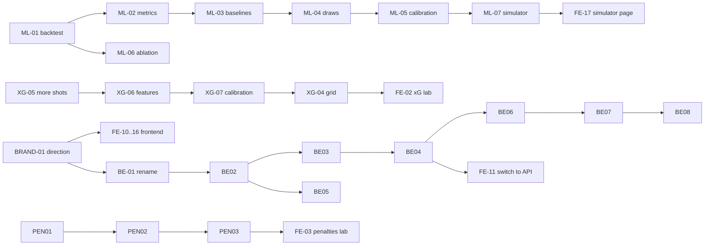

# Neutral Ground: Roadmap

> Formerly **Premalytics**. The project started as a Premier League tool, pivoted to World Cup 2026, and is now
> branded around **international football** as a whole. WC 2026 is the flagship case study; Euro 2028, AFCON 2027,
> Copa América 2028, and WC 2030 qualifying are the next tournaments the same models cover.

This file is the single source of truth for outstanding work. `docs/WC_HANDOFF.md` and `docs/WC_SPEC.md` remain the
historical record of the pivot (tickets WC-00 → WC-07, XG-01 → XG-04, PEN-01 → PEN-03, FE-01 → FE-03) and their rules
(chronological splits only, no leakage, no betting advice) still apply.

Last updated: 2026-11-21.

---

## 1. Where things stand

| Area | State | Evidence |
|------|-------|----------|
| Match outcome model (Track 1) | Shipped. GBM + logistic on a 30,417-match international corpus, 123 features (Elo, rolling form, xG, confederation, H2H). | `ml/artifacts/20260722_002607/metrics.json` |
| WC 2026 retrospective | Served blend, leak-free: 68/104, log loss 0.732 shootout-credited; strict 65.4%, 0.815. Previous GBM leak-free: 70/104, 0.764 / 0.861. The earlier 72/104 / 0.681 run leaked in-tournament form (found and fixed in ML-01, PR #14). | `data-pipeline/data/evaluation/wc2026/20261121_144554/` |
| Score model | Home/away goal regressors on xG + Elo + confederation features. | `ml/artifacts/score_20260721_231448/` |
| Shot xG (Track 2) | Shipped but thin: 1,624 training shots (WC 2018 only) and 1,417 eval shots, 5 features. Logistic (Brier 0.0870, LL 0.300) beats GBM (Brier 0.0872, LL 0.329). | `ml/artifacts/shot_xg_20260628_010155/shot_metrics.json` |
| Penalties (Track 3) | **Not started.** PEN-01 → PEN-03 in `WC_HANDOFF.md` never ran. | — |
| Backend | Two POST endpoints that spawn a Python process per request. No persistence, read endpoints, validation, tests, or deploy story. | `backend/src/main/java/com/premalytics/` |
| Frontend | Still the Premier League mock UI (clubs, players, league table). Never wired to real data. | `frontend/src/data/mock*.ts` |
| Brand | Name and copy still say Premalytics / Premier League in places. | README, backend package, frontend |

### Known model weaknesses (from the WC 2026 report)

1. **Draws.** All five worst misses were draws the model priced at 17–19%. Draws were 0-0 or 2-2 between a favorite and
   an underdog. The model almost never picks a draw, so every draw is a miss.
2. **Tiny, flattering holdout.** 104 matches is one tournament. The credited log loss (0.764) redistributes knockout
   draw probability to the two teams, which is not comparable to the raw 0.861. Report both, always.
3. **No external benchmark.** ML-01 found the GBM does no better than a 2-feature Elo logistic; the served blend now beats it by a small margin. No free closing-odds source exists.
4. **xG trained on one tournament.** Train set smaller than eval set; GBM overfits; no freeze-frame features.

---

## 2. Brand (BRAND)

| Ticket | Scope | Done when |
|--------|-------|-----------|
| BRAND-01 | Name, tone, visual identity. Direction lives in `PRODUCT.md`. | `PRODUCT.md` Direction block written. ✅ |
| BRAND-02 | Frontend rebrand: wordmark, metadata, all copy. | No "Premalytics" or "Premier League" in `frontend/src`. |
| BRAND-03 | Docs + README rename. | README headline and stack section updated. |
| BRAND-04 | Backend package `com.premalytics` → `com.neutralground`, artifact id, app name, log banner. | `mvn test` green after rename. |
| BRAND-05 | Python report strings (`PREMALYTICS — WORLD CUP 2026 PREDICTION REPORT`, etc.). | `grep -ri premalytics ml data-pipeline/scripts` is empty. |
| BRAND-06 *(user)* | Rename GitHub repo and local folder; register a domain if wanted. | Manual: the user does this. |

---

## 3. ML (ML, XG, PEN)

Rules from `WC_SPEC.md` hold: chronological splits only, `shift(1)` on every rolling feature, artifacts in
`ml/artifacts/`, `python -m pytest ml/tests -q` green before any ticket is done.

### Track 1: match model

| Ticket | Scope | Done when |
|--------|-------|-----------|
| ML-01 Walk-forward backtest ✅ Done (PR #14) | Replace the single 104-match holdout with rolling-origin evaluation across every major tournament 2014–2026 (WC, Euro, Copa, AFCON, Asian Cup, Gold Cup). Train on everything before each tournament's first match; score that tournament. | `python -m ml.pipeline.backtest` writes per-tournament and pooled metrics JSON. Several hundred to ~1,000 scored matches. |
| ML-02 Proper metrics ✅ Done (PR #14) | Add **Ranked Probability Score** (the standard for ordered W/D/L), Brier, reliability bins, and always report raw and shootout-credited numbers side by side. | Metrics JSON has `rps`, `brier`, `log_loss_raw`, `log_loss_shootout_credited`, `reliability`. |
| ML-03 Baselines to beat ✅ Done (PR #14) | Elo-only logistic, FIFA-rank-only logistic, "always home/favorite", and (if a free closing-odds source exists for international matches) market-implied probabilities. | Backtest table shows the GBM vs every baseline. A model that does not beat Elo-only is reported as such. |
| ML-04 Draw modeling ✅ Done (PR #14) | Derive W/D/L from a **Dixon-Coles** bivariate Poisson score model (low-score correlation term ρ) and/or an ordinal logistic model, then stack with the GBM. Re-tune `tune_draw_calibration.py` on walk-forward folds, not on WC 2026. | Draw recall and RPS improve on the backtest without worsening log loss. |
| ML-05 Calibration ✅ Done (PR #14) | Temperature scaling or isotonic per fold; reliability diagram data exported for the frontend. | Calibration error reported per decile; `reliability.json` artifact. |
| ML-06 Feature ablation | Ablate xG, confederation, H2H, rest days, travel distance, and an `is_knockout` flag. `is_knockout` depends on fixing martj42 stage inference (`04_normalize_martj42.py` `stage_for()` labels every non-friendly/qualifier match as `group`). Keep that fix as its own ticket. | Ablation table in `docs/ML_EXPERIMENTS.md`; only features with measured lift stay. |
| ML-07 Tournament simulator | Monte Carlo of a full tournament bracket from match probabilities (group tables with tiebreakers, R32 → final). | `python -m ml.pipeline.simulate --tournament wc2026` emits each team's probability of reaching each round. Feeds a frontend page. |
| ML-08 Uncertainty | Bootstrap confidence intervals on every headline accuracy/log-loss number. | Report and frontend show "65% (95% CI a–b)". |

### Track 2: shot xG (the second model)

| Ticket | Scope | Done when |
|--------|-------|-----------|
| XG-05 More shots | StatsBomb open data also covers Euro 2020, Euro 2024, Copa América 2024, AFCON 2023, plus WC 2022. Ingest every international competition available, then split by tournament date. | Training set ≥ 8,000 non-penalty shots; split documented. |
| XG-06 Better features | At-release features only: freeze-frame (defenders between ball and goal, keeper distance and angle, nearest defender distance), `under_pressure`, `first_time`, technique, assist type (through ball, cross, cut-back), header vs foot. Update `DATA_CONTRACT_SHOTS.md`; keep forbidden post-shot columns forbidden. | GBM beats logistic on held-out Brier and log loss, or the doc states logistic is retained. |
| XG-07 Calibration and validation | Reliability buckets; compare summed model xG per match to actual goals per match. | `shot_xg_metrics.json` includes calibration buckets and per-match totals. |
| XG-04 Inference contract *(open from handoff)* | `predict_shot` CLI is sub-100 ms; also export a precomputed grid (distance × angle × body part × situation) as JSON for the frontend xG lab. | `xg_grid.json` artifact; schema documented. |

### Track 3: penalties (the third model)

The handoff tickets stand; concrete source is now known.

| Ticket | Scope | Done when |
|--------|-------|-----------|
| PEN-01 Data audit | StatsBomb open events carry penalty and shootout kicks with end location (placement) and keeper action for WC 2018/2022, Euro 2020/2024, Copa 2024, AFCON 2023. Count kicks, missing fields, shootout vs in-game. | `docs/PENALTY_DATA_AUDIT.md` with a go/no-go table (GBM optional if < ~200 labeled kicks). |
| PEN-02 Label spec + v0 dataset | One row per kick; features at the kick moment only (taker foot, shootout order, score state, in-game vs shootout, keeper). Placement zones (3×3 goal grid). | `docs/PENALTY_LABEL_SPEC.md`, `data-pipeline/scripts/penalties/01_build_penalty_csv.py`, `penalty_kicks_v0.csv` with `source` column. |
| PEN-03 Baselines | Marginal conversion by zone, foot × side, shootout order, and pressure ("kick to stay alive"). Optional GBM only if PEN-01 says go and it beats the baseline. | `ml/models/penalty_baselines.py`, `ml/pipeline/evaluate_penalties.py`, `docs/PENALTY_LIMITATIONS.md`, `penalty_aggregates.json` for the frontend. |

Non-goal unchanged: no headline that "predicts" a keeper's dive or a shootout winner with high confidence.

---

## 4. Backend (BE)

Today: Spring Boot with `POST /api/predictions/match` and an xG endpoint, each spawning `python -m ml.pipeline.*` per
request (cold model load every call), building a CSV by string concatenation (a comma in a field breaks it), no
persistence, no tests beyond the context-load test.

**Target architecture.** Spring Boot stays the public API. Predictions for known fixtures are computed in batch by the
Python pipeline and loaded into Postgres. Ad-hoc inference (xG sliders, "what if A played B") goes to a long-lived
Python inference service (FastAPI) that loads models once. Spring never shells out.

| Ticket | Scope | Done when |
|--------|-------|-----------|
| BE-01 Rename | BRAND-04. | `mvn test` green. |
| BE-02 Schema + migrations | Flyway migrations replacing `database/schema/*.sql` (`pl_data` → `ng`): `teams`, `tournaments`, `matches`, `predictions` (model run id, probabilities, predicted score), `model_runs` (metrics JSON), `shots_xg_grid`, `penalty_aggregates`. | Migrations apply on a fresh Postgres; Testcontainers test proves it. |
| BE-03 Loader | Python `ml.pipeline.publish` writes a model run's predictions + metrics into Postgres (or emits SQL/CSV the backend imports). | One command publishes the WC 2026 run. |
| BE-04 Read API | `GET /api/tournaments`, `/api/tournaments/{id}`, `/api/tournaments/{id}/matches?stage=`, `/api/matches/{id}`, `/api/teams`, `/api/teams/{code}` (Elo history, results, predictions), `/api/model-runs/latest` (scorecard), `/api/xg/grid`, `/api/penalties/aggregates`. Paged where lists can grow. | springdoc OpenAPI at `/api/docs`; frontend can switch from static JSON to API by env var. |
| BE-05 Inference service | `ml/serve/` FastAPI app: `POST /predict/match`, `POST /predict/shot`; models loaded at startup; Spring calls it via `RestClient` with timeouts. | p95 < 100 ms locally; Spring `ProcessRunner` deleted. |
| BE-06 Hardening | Bean Validation on DTOs (team code `^[A-Z]{3}$` against the team table, date format), `@RestControllerAdvice` error model, CORS from config not wildcard, rate limit on POST endpoints, Actuator health/readiness, response caching on read endpoints. | Invalid input → 400 with field errors; no stack traces leak. |
| BE-07 Tests | Controller slice tests (`@WebMvcTest`), service tests with a fake inference client, Testcontainers integration test for the read API. | `mvn test` covers every endpoint. |
| BE-08 Run + deploy | Dockerfiles for API and inference service, `docker-compose.yml` (postgres, api, ml-serve, frontend), GitHub Actions CI running `pytest`, `mvn test`, `npm run build`/`lint`. | `docker compose up` brings up the whole stack. |

---

## 5. Frontend (FE)

Direction is in `PRODUCT.md`. The Premier League mock UI is replaced, not extended.

| Ticket | Scope | Done when |
|--------|-------|-----------|
| FE-10 Design system | Tokens, type, color (light + dark), core components. | All color/font values via tokens. |
| FE-11 Data layer | `frontend/scripts/build-data.mjs` turns repo outputs (scored predictions, fixtures, results, metrics, team map) into typed JSON under `frontend/src/data/generated/`. `VITE_API_URL` switches to the BE-04 API when it exists. | `npm run data` regenerates; no hand-written mocks. |
| FE-12 Home | The WC 2026 record as the story: headline accuracy, how each round went, biggest calls and misses. | Real numbers only. |
| FE-13 Tournament view | WC 2026 groups, bracket, and every match with predicted probabilities vs the result. Filters by stage. | 104 matches render; mobile usable. |
| FE-14 Match detail | Probability bar, predicted vs actual, model pick, what the model got wrong. | Every match has a page. |
| FE-15 Nations | Team index (48 WC 2026 nations) and team page (their matches, model record on them). | |
| FE-16 Method | Plain-language "how the model works and where it fails" page: data, features, splits, metrics, limits. | No claim the numbers don't support. |
| FE-02 xG lab *(open from handoff)* | Pitch with draggable shot location → model xG from the XG-04 grid. Label: "model estimate, not official xG". | After XG-04. |
| FE-03 Penalties lab *(open from handoff)* | Goal-mouth heatmap of conversion by zone. "Experimental" label. | After PEN-03. |
| FE-17 Simulator | Bracket odds from ML-07. | After ML-07. |
| FE-18 Remove legacy | Delete EPL mocks, Players/PlayerDetail/Standings pages, unused components. | No dead routes. |

---

## 6. Order of work

Three lanes run in parallel: **frontend** (FE-10 → FE-16), **ML** (ML-01 → ML-05, then XG and PEN), **backend**
(BE-01 → BE-08). The frontend ships on static JSON first and switches to the API once BE-04 lands.
